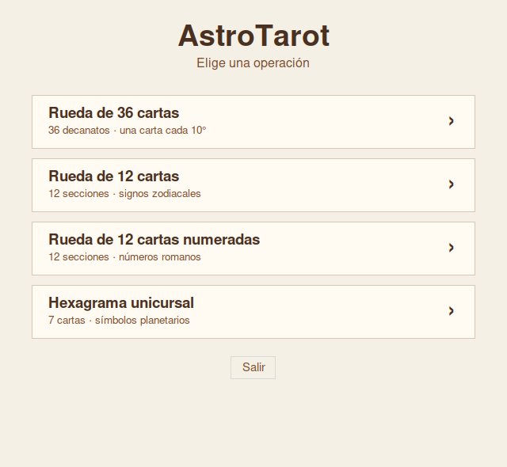
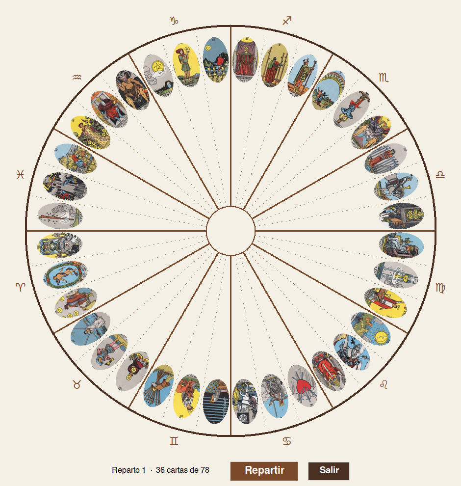
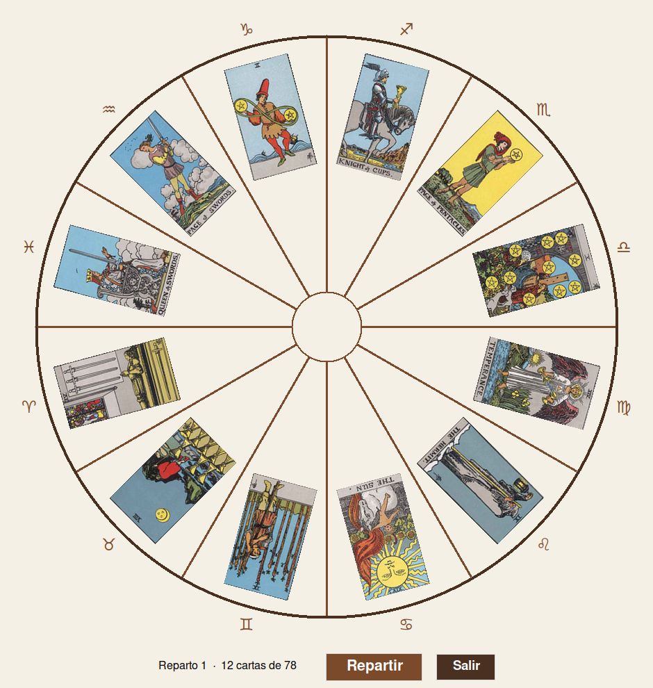
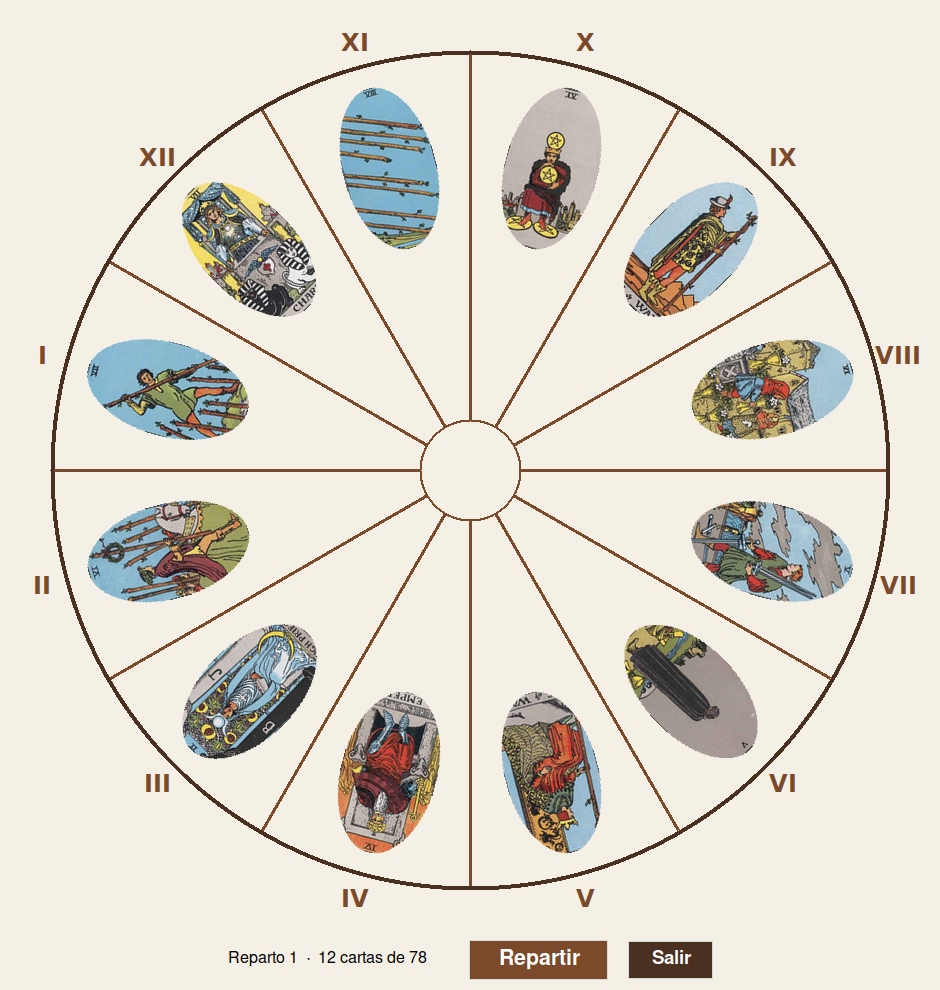
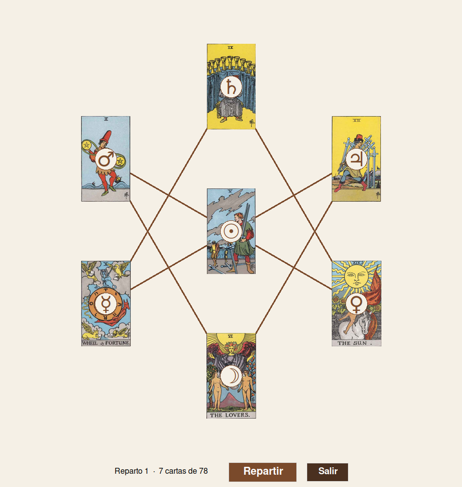

# AstroTarot — Ruedas y figuras de tarot

Aplicaciones en **Python 3** con **Tkinter** que reparten cartas de tarot sobre
ruedas circulares divididas en secciones astrológicas y sobre un hexagrama
unicursal.

## Menú de inicio

`menu_inicio.py` abre una ventana gráfica con los cuatro repartos disponibles.
Al elegir una opción, el programa se inicia en una ventana independiente. El
botón **Salir** de cada programa cierra su ventana y vuelve a abrir el menú de
inicio.

```bash
python3 menu_inicio.py
```

<p align="center">
  
</p>

## Rueda de 36 cartas

`repartir_36_decanatos.py` dibuja un círculo dividido en **12 secciones de 30°**, cada
una subdividida en **3 porciones de 10°** (36 porciones en total). Al pulsar el
botón **Repartir** se seleccionan **36 cartas de las 78** disponibles, sin
repetición, y se coloca una imagen en cada porción de 10°:

- 3 cartas por cada sección de 30°.
- Una imagen por cada porción de 10°.
- La sección 0° comienza a las **9 en punto** y avanza en **sentido
  antihorario** (de izquierda a derecha por arriba).
- Las cartas se muestran con su parte superior apuntando hacia el exterior de
  la rueda.
- El orden de las secciones es fijo; lo que cambia en cada reparto son las
  cartas.

Las divisiones gruesas marcan las secciones de 30° y las líneas punteadas
finas las porciones de 10°.

<p align="center">
  
</p>

## Rueda de 12 cartas

`repartir_12_signos.py` dibuja una rueda dividida en **12 secciones de 30°** y
reparte **una carta aleatoria en cada sección**, sin repetición, tomándola de
las 78 cartas disponibles. Las cartas se colocan en el centro de cada sección,
con su parte superior hacia el exterior de la rueda.

<p align="center">
  
</p>

## Rueda de 12 cartas numeradas

`repartir_12_casas.py` es una variante de la rueda de 12
cartas que sustituye los símbolos zodiacales por los **números romanos del I al
XII**, manteniendo una carta aleatoria por sección.

<p align="center">
  
</p>

## Hexagrama unicursal de 7 cartas

`repartir_7_hexagrama.py` dibuja un **hexagrama unicursal** de una sola línea y
reparte **7 cartas aleatorias sin repetición**: una en cada uno de los **6
vértices externos** y una en el **centro**. Todas las cartas se muestran
derechas, con su base hacia abajo, y conservan sus bordes rectangulares.

Sobre cada carta se dibuja un símbolo planetario: **Saturno** en el ápice
superior, **Júpiter** en el superior derecho, **Venus** en el inferior derecho,
la **Luna** en el inferior, **Mercurio** en el inferior izquierdo, **Marte** en
el superior izquierdo y el **Sol** en el centro.

<p align="center">
  
</p>

## Características

- Interfaz gráfica ligera con Tkinter.
- Reparto aleatorio **sin repetición** mediante `random.sample`.
- Cuatro modalidades: 36 cartas en porciones de 10°, 12 cartas con símbolos
  zodiacales, 12 cartas con números romanos o 7 cartas sobre un hexagrama
  unicursal.
- Cartas rotadas con `Pillow`; en las ruedas se recortan en forma de elipse y
  en el hexagrama conservan sus bordes rectangulares.
- La ventana se **ajusta automáticamente a la resolución de la pantalla**;
  todos los elementos de la rueda se escalan de forma proporcional.
- Contador de repartos y total de cartas usado.

## Requisitos

- Python 3.8 o superior.
- Tkinter (incluido con Python en la mayoría de distribuciones).
- Pillow.

En Debian/Ubuntu, si faltan dependencias:

```bash
sudo apt install python3-tk
pip install -r requirements.txt
```

## Instalación

```bash
git clone https://github.com/ahorsmann777/AstroTarot.git
cd astrotarot
pip install -r requirements.txt
```

Las imágenes de las cartas deben estar en una carpeta llamada **`Cartas`**
(formato JPG) junto al script. Se buscan en este orden:

1. `Cartas` junto al script
2. `Cartas` en el directorio de trabajo
3. `astrotarot/Cartas` junto al script o en el directorio de trabajo

## Uso

También puedes ejecutar cada programa directamente.

Rueda de 36 cartas:

```bash
python3 repartir_36_decanatos.py
```

Rueda de 12 cartas:

```bash
python3 repartir_12_signos.py
```

Rueda de 12 cartas con números romanos:

```bash
python3 repartir_12_casas.py
```

Hexagrama unicursal de 7 cartas:

```bash
python3 repartir_7_hexagrama.py
```

Una vez abierta la ventana, pulsa el botón **Repartir** para realizar un nuevo
reparto aleatorio.

> **Nota:** las 78 cartas incluidas en `Cartas/` corresponden a los arcanos
> mayores y menores del tarot de Rider-Waite.

## Estructura del proyecto

```
astrotarot/
├── menu_inicio.py                # Menú gráfico de inicio
├── repartir_36_decanatos.py      # Rueda de 36 cartas (porciones de 10°)
├── repartir_12_signos.py         # Rueda de 12 cartas (secciones de 30°)
├── repartir_12_casas.py          # Rueda de 12 con números romanos
├── repartir_7_hexagrama.py       # Hexagrama unicursal de 7 cartas
├── Cartas/                       # Las 78 cartas en formato JPG
├── docs/                         # Capturas de previsualización
├── requirements.txt
└── README.md
```

## Cómo funciona

- **Geometría:** la rueda parte de la sección 0° en las 9 en punto y gira en
  sentido antihorario. Las divisiones se dibujan cada 10° (finas y punteadas)
  y cada 30° (gruesas). En el exterior se muestran los signos zodiacales o,
  en la variante numerada, los números romanos del I al XII.
- **Hexagrama:** se dibuja un hexagrama unicursal con una sola línea que recorre
  sus 6 vértices. Las 6 cartas exteriores se colocan en esos vértices y la
  séptima en el centro. Encima de cada carta se dibuja su símbolo planetario.
- **Reparto:** `random.sample` elige 36 cartas de las 78 (o 12, o 7 según la
  figura); cada carta se redimensiona con Pillow. En las ruedas se recorta en
  forma de elipse y se rota según la inclinación de su porción o sección; en el
  hexagrama se mantienen los bordes rectangulares con las esquinas
  transparentes y todas las cartas quedan derechas.
- **Ajuste a pantalla:** el tamaño del lienzo se calcula a partir de
  `winfo_screenwidth/height` dejando márgenes para la barra de botones; las
  dimensiones de la rueda o figura y el tamaño de las cartas se escalan
  proporcionalmente.

## Licencia

Este proyecto se distribuye bajo la licencia **MIT**. Consulta el archivo
[LICENSE](LICENSE) para más detalles.
